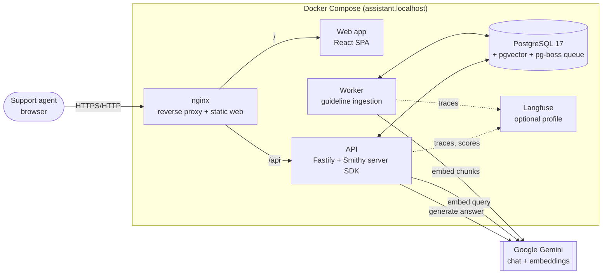

# High-Level Design: AI Support Assistant

Version 1.1, 2026-10-10 (1.0 on 2026-09-13). Companion documents: `docs/lld.md` (component-level design),
`docs/evaluation-report.md` (measurements behind the tuning decisions).

## 1. Problem statement

Customer-support agents at small companies answer the same kinds of tickets every day, but the
correct handling lives in each company's guideline document: who to escalate to, when to offer a
refund, which steps to try before reinstalling. Agents either memorise those documents or search
them by hand while the customer waits.

The assistant sits next to the agent. The agent picks the company, pastes the customer's message
(or types an instruction such as "make it shorter"), and receives a recommendation grounded in
that company's current guidelines: the handling steps, what to clarify with the customer, which
calls are the agent's to make, whether to escalate, and a reply the agent can copy. When the
guidelines do not cover the question, the assistant says so and recommends escalation instead of
improvising.

Constraints agreed with the reviewer that shaped the design:

| Requirement                                                                                          | Consequence                                                                                                                                   |
| ---------------------------------------------------------------------------------------------------- | --------------------------------------------------------------------------------------------------------------------------------------------- |
| Answers must come from the uploaded guidelines only, without pasting whole documents into the prompt | Retrieval-augmented generation: guidelines are chunked, embedded and retrieved per turn                                                       |
| Guidelines are `.txt`, `.docx` or `.pdf` and can be replaced at any time                             | Versioned ingestion pipeline; the previous version stays live until the new one is ready                                                      |
| Conversations are multi-turn                                                                         | Conversation history in the prompt, with a rolling summary for long threads                                                                   |
| Any authenticated agent may work on any company; no roles                                            | Token-based auth on the API and UI; companies, guidelines and corrections are shared, conversations are private to the agent who started them |
| Two companies pre-seeded, more can be created                                                        | Company CRUD plus a seed step                                                                                                                 |
| Uncovered questions handled "for real life"                                                          | Explicit coverage verdict and escalation in the output; server-side gate independent of the model                                             |
| Local delivery with Docker Compose                                                                   | Everything, including the reverse proxy and optional observability stack, runs from one compose file                                          |
| Chat history and agent feedback                                                                      | Per-agent history with "why this answer"; thumbs up/down with corrections that feed later answers                                             |

## 2. High-level architecture

Six moving parts, one external dependency:

| Block          | Responsibility                                                                                                                                                          |
| -------------- | ----------------------------------------------------------------------------------------------------------------------------------------------------------------------- |
| **Web app**    | Login, company and guideline management with upload progress, chat, history, feedback. English and German.                                                              |
| **nginx**      | Single entry point on `assistant.localhost`: serves the built SPA, proxies `/api`, mints request ids, terminates TLS when the optional certificate is present.          |
| **API**        | Contract-first HTTP API generated from a Smithy model: auth, companies, guideline versions, conversations (the RAG turn), feedback. Stateless; scales horizontally.     |
| **Worker**     | Same image as the API, different entry point. Consumes ingestion jobs: parse file, chunk by heading, embed, activate the version. Resumable and idempotent.             |
| **PostgreSQL** | System of record for everything: users and sessions, companies, guideline versions and chunks with their vectors, conversations, messages, feedback, and the job queue. |
| **Gemini**     | `gemini-3.8-flash` (medium thinking) for structured answers and history summaries, `gemini-embedding-2` (768 d) for chunk and query vectors.                            |
| **Langfuse**   | Self-hosted, off by default. One trace per chat turn and per ingestion, agent feedback attached as scores.                                                              |

### 2.1 The four flows

**Sign in.** Username and password (seeded users) exchange for a 15-minute access token and a
7-day rotating refresh token. The web app refreshes proactively and replays a request once on a 401. Logout revokes the whole refresh-token family.

**Upload guidelines.** The API stores the file bytes as a new guideline _version_ (status
`queued`) and enqueues a job, returning immediately. The worker parses, chunks and embeds in
batches, updating progress counters the UI polls. When the version is `ready` it becomes the
company's active version; the previous one is kept for rollback. A newer upload supersedes an
in-flight one; a concurrent upload from another agent is rejected with a conflict the UI explains.

**Chat turn.** The API embeds the retrieval query, fetches the top guideline sections of the
active version and any similar corrections (plus, when a distinctive keyword points at a section
the vectors missed, that one section), builds a prompt from system rules, rolling summary,
recent history and retrieved context, and asks Gemini for a JSON answer with a fixed schema. A
server-side gate then enforces the coverage verdict and citation validity before the message is
stored with its retrieval scores, tokens, latency and trace id.

**Feedback.** Thumbs up or down on an answer, with "what was wrong" and the corrected reply for a
thumbs down. Corrections are embedded and stored per company and guideline version, retrieved as
few-shot examples for similar later questions, pushed to Langfuse as scores, and deactivated when
the guidelines they were written against are replaced.

## 3. Important decisions

Each entry states the choice, the alternatives considered, and why. Tuning values marked with
"measured" have their evidence in the evaluation report.

### 3.1 Platform and language

**TypeScript end to end (Node 22).** One language for the web app, API, worker, evaluation
harnesses and generated SDK; shared types from one OpenAPI document. Java would have given the most
mature Smithy tooling but split the team's context; Python has the richest ML libraries but the
project's ML surface is two HTTP calls to Gemini.

**Spec-first API with Smithy.** The HTTP contract is a Smithy model; from it we generate the
server SDK (routing, validation, serialization, typed errors) and an OpenAPI document, from which
the web client's types are generated. Alternatives: hand-written Fastify routes with zod (faster to
start, contract drifts), tRPC (TypeScript-only clients, no OpenAPI), OpenAPI-first with generators
(weaker server-side typing). Smithy keeps the contract authoritative and reviewable in one place;
the cost is a JDK for regeneration, absorbed by committing the generated code and offering a
Docker-based codegen profile.

**Fastify as the HTTP host.** Thin adapter between Fastify and the Smithy server SDK; Fastify
gives us request logging, body limits, Swagger UI hosting and a mature plugin ecosystem without
fighting the SDK's routing.

### 3.2 Data and infrastructure

**PostgreSQL for everything, pgvector for embeddings.** Considered a dedicated vector store
(Qdrant, Weaviate, Pinecone). Rejected because the corpus per company is small (tens to a few
hundred sections), vectors must be deleted or superseded together with their guideline version,
and retrieval must join on the _active_ version. One database gives transactional consistency
between versions, chunks and vectors, one backup, one thing to run locally. pgvector with an HNSW
cosine index handles this scale with room to spare. Full-text search stays in the same database:
a generated `tsvector` column on the chunks backs the keyword rescue (evaluation report §5.1),
which appends one section that the vector ranking missed but a distinctive word of the message
points at ("cancel"); full hybrid ranking was evaluated and not adopted.

**pg-boss for the job queue, not Kafka or SQS.** Ingestion is the only asynchronous workload and
needs at-least-once delivery, retries with backoff (5 attempts, exponential from 5 s) and
visibility, not high throughput or fan-out. pg-boss stores jobs in Postgres, so there is no broker
to run and job state is queryable next to the data it changes. A broker becomes worth its cost
when there are several consumers or the queue outgrows the database; the queue interface is
abstracted so that swap is local.

**Keyset pagination for lists and threads, denormalised last coverage.** The conversation list
and the messages of a conversation are both paged with an opaque "timestamp|id" cursor over an
indexed order (last activity for conversations, creation time for messages), so a company with
thousands of threads or a thread with thousands of turns costs one indexed range scan per page.
The web app loads the newest 50 messages and offers _Load earlier messages_. The coverage of the
latest answer is stamped on the conversation (`last_coverage`, indexed with last activity) so the
history filter is an equality, not a per-row subquery.

**Polling for progress, not WebSockets.** Ingestion progress changes every few seconds and only
one agent watches it at a time. The UI polls the version endpoint every 2 s while a version is in
flight. WebSockets or SSE would add a stateful connection path through nginx for a marginal UX gain;
they are reserved for a future multi-agent live workspace.

**nginx in front, one local domain.** All traffic enters through `assistant.localhost` on port
80 (or 443 with the mkcert override). nginx serves the static SPA with immutable asset caching,
proxies `/api` with a longer timeout on chat routes, mints the request id that flows through logs
and traces, and hides the internal ports. It is the same shape a production deployment would have
behind a load balancer.

**Docker Compose, multi-target Dockerfile.** One image builds the API and worker (different
entry points) and one builds nginx with the web bundle; dev targets run Vite with hot reload behind
the same nginx. Health checks live in compose so the worker, which has no HTTP port, does not inherit
an API health check. Langfuse and its four backing services sit behind a compose profile because
they need about 2 GB of RAM and are not required to use the product.

### 3.3 The model layer

**Gemini as the single provider.** The brief asked for Gemini; the provider is isolated behind
two interfaces (`ChatModel`, `Embedder`) with fake implementations for tests, so a second provider
is an adapter, not a refactor. `gemini-3.6-flash` was adopted when `gemini-2.5-flash` was withdrawn
for new users, and replaced by `gemini-3.8-flash` on 2026-10-10 (the newest Flash on the key; the
thinking level is pinned to `medium` by `GEMINI_THINKING_LEVEL`, the setting the evaluation found
to match 3.6 on quality at similar latency, see `docs/evaluation-report.md` §7.1); the Interactions API was evaluated and not adopted because the request/response
`generateContent` call with a response schema fits a stateless API better.

**Embeddings at 768 dimensions (measured).** `gemini-embedding-2` (and `gemini-embedding-001`
before it) supports 768, 1536 and 3072.
On the evaluation set 768 was best or tied on every metric (top-1 82.5 %, expected section in the
prompt 100 %); 3072 was strictly worse and would need pgvector `halfvec`. The 2026-10-10 re-run
on `gemini-embedding-2` agrees: 1536 matches 768 on top-1 (84.8 %) and recall (98.7 % with
vectors, 100 % with the rescue). Cost is per input token,
not per dimension, so larger vectors only cost storage. The column is `vector(768)` and both
services refuse to start if the configured dimension differs, because a mismatch would corrupt
retrieval silently.

**Chunking strategy: one chunk per guideline section, windows as the fallback.**

_Alternatives considered._

| Strategy                                                         | Why not (for this product)                                                                                                                                      |
| ---------------------------------------------------------------- | --------------------------------------------------------------------------------------------------------------------------------------------------------------- |
| Whole document in the prompt                                     | Ruled out by the reviewer; no citations, cost grows with the document, and irrelevant sections dilute the answer                                                |
| Fixed token windows (e.g. 500 tokens, 50 overlap)                | Cuts procedures mid-list and separates a section's "Approach" from its "Sample reply"; citations become "chunk 7"; two half-topics compete in retrieval         |
| Paragraph or sentence windows (recursive splitting)              | Cleaner edges than fixed windows, but a guideline topic spans several paragraphs, so the same topic-splitting problem remains                                   |
| Semantic chunking (split where sentence embeddings diverge)      | Extra embedding calls per upload, non-deterministic boundaries that are hard to explain to an agent, and it rediscovers structure the document already declares |
| LLM-based sectioning                                             | A generation per upload adds cost and a new failure mode to ingestion for structure that is already explicit                                                    |
| Hierarchical (small chunks for search, parent section in prompt) | The right upgrade when sections are long; not needed while a section fits in one chunk, so deferred (see below)                                                 |

_Why heading-aware._ Support guidelines are authored by topic: "4. Returns and Refunds" with
an approach and a sample reply under it. The unit an agent needs is exactly that section, so the
retrieval unit should be the same. One chunk per section keeps the whole procedure together, lets
citations name a section the agent recognises, is deterministic (the same file always chunks the
same way, which matters for versioning and for the evaluation harness), and measured well: the
expected section reached the prompt for 100 % of the labelled tickets.

_How it works._ Text is normalised (line endings, control characters, blank-line runs). A line
is a heading when it matches one of three patterns: numbered (`1.` or `1)` followed by a short
title of at most 12 words with no terminal punctuation), Markdown (`#` to `######`), or an
all-capitals line of 3 to 80 characters. Each heading starts a section; the heading text is
stored as the chunk title and embedded together with the body, so the vector carries the topic
name as well as its content. Token counts are estimated at about four characters per token,
which is sufficient for sizing.

_When a section is big._ A section up to 800 estimated tokens is one chunk. Above that it is
split at paragraph boundaries into windows of about 400 tokens with a 60-token overlap carried
from the previous window, titled "Section name (part 1)", "(part 2)" and so on; a pathological
paragraph with no blank lines is split by sentence. Each part is retrievable on its own and the
citation shows which part was used. The trade-off is that a long procedure can span two parts and
both may occupy slots in the top 4. If a customer's guidelines routinely exceed 800 tokens per
section, the next step is hierarchical retrieval: search the parts, put the parent section in the
prompt. The chunker already records title and ordinal, so that is an additive change.

_When the document is not structured like the samples._ If no line matches a heading pattern,
the whole document becomes one untitled section and falls through to the same windowing, so
ingestion never fails for lack of headings; citations then show a chunk number instead of a
title, and the retrieval evaluation was run on structured documents only, so recall on
unstructured text is not measured. Headings in styles the patterns do not recognise (Title Case
lines without numbers, "Refunds:" with a colon, bold-only headings in `.docx` and `.pdf`, where
formatting is lost at text extraction) are treated as body text and windowed. Two mitigations
are in place: the extracted text and the resulting chunk titles are shown in the product right
after ingestion, so whoever uploaded the file sees how it was split, and the heading patterns are
three regular expressions with unit tests, so adding a house style is a small, testable change.
The known gaps are listed in §8.

**Retrieval: top 4 sections at a 0.55 similarity floor (measured).** Four sections cover
multi-topic tickets (a late delivery that is also damaged) while keeping the prompt small. The
floor is deliberately low: the evaluation showed no threshold that separates out-of-scope
questions from in-scope ones, and every value above 0.55 started blocking legitimate questions.
The floor prevents empty-context answers; out-of-scope handling is the model's and the gate's job.

**Keyword rescue for the words vectors miss (measured).** A short, emotional message ("Worst VPN
I've ever paid for. Cancel everything.") embeds as "angry customer", so every technical section
outranks Billing. After the vector top 4, one Postgres full-text query appends at most one section
that a distinctive word of the message points at: a stemmed content word that occurs in at most a
quarter of the sections and at least twice in the candidate. The vector order is never changed, so
the measured top-1 behaviour is untouched; full hybrid ranking was evaluated first and rejected
because it lowered top-1 (evaluation report §5 and §5.1).

**Structured output with a fixed JSON schema.** Gemini is called with `responseSchema`, so the
answer is always the same object: coverage verdict, handling steps, clarifications, agent
decisions, escalation, recommended reply, citations, notes. The UI renders sections, not prose;
the server can validate and gate; evaluation can score fields. Free-text answers would have made
the coverage requirement unenforceable.

**Server-side coverage gate.** The model's own verdict is not trusted alone. If no section clears
the floor the answer is forced to `not_covered` with an escalation; citations are restricted to
sections that were actually provided; a reply containing source code is downgraded. This is the
"handled for real life" requirement implemented where it cannot be prompted away.

**Prompt budget 120k tokens, history window 12 messages, rolling summary.** The model accepts
1,048,576 input tokens (verified via the API); we cap our own prompts at 120k for cost, latency
and focus, and in practice a turn uses 3 to 6k. The last 12 messages (six exchanges) are replayed
verbatim with older assistant turns compacted to verdict plus reply; anything older is folded into
a one-paragraph summary that is extended incrementally and stored on the conversation, so a
50-turn chat still knows the order number from turn one. The budget is a safety net that trims
oldest-first if a pasted email is enormous. Window and budget are environment variables; 12 is a
chosen default for typical thread length, not a measured optimum.

**Output budget 8192 tokens (measured).** The model allows 65,536 output tokens. Our first
setting of 2048 truncated a quarter of answers mid-JSON because a thinking model's reasoning
counts against the same budget. 8192 leaves room to reason and emit the full object while still
capping runaway generations; the finish reason is checked and surfaced as a specific error.
The thinking level is pinned to `medium`: at `high` the same model spent up to 31k tokens
reasoning on one answer, which no fixed budget survives.

**Prompt-injection defences.** Customer text is untrusted input: it is wrapped in delimiters with
spoofed closing tags stripped, the system prompt states that instructions inside it are never
followed, the schema constrains what can come out, and the gate catches the common "write me
code" escape. Agent instructions use a separate delimiter and are trusted.

**Prompts as reviewable templates.** Every fixed piece of text sent to the model lives in
`api/prompts/*.md` with `{{placeholders}}`; the code only assembles the dynamic parts (sections,
corrections, history). A wording change is therefore a one-file diff, and rendering fails at
start-up if a placeholder is left unfilled. Two rules were added this way after acceptance
testing: sample replies must not be copied as if the lookup had happened (ask for the order
number instead of "I have checked with the courier"), and a message too vague to pick a section
is answered with a clarifying question and coverage "partial".

### 3.4 Feedback as golden data

Thumbs down with a corrected answer is the most valuable signal the product collects, so it is
stored as structured data rather than a comment: the customer question it answered, its
embedding, what was wrong, the corrected reply, the guideline version. Later questions retrieve
similar corrections (similarity 0.65 and above, measured) as few-shot examples marked as lower
authority than the guidelines. The evaluation showed one more step was needed: when a correction
matches but the customer's paraphrase misses the guideline section, the correction alone cannot
ground the answer, so the sections retrieved by the correction's original question are pulled in
as well (correction-anchored retrieval). With that in place the judged answer quality on the
correction set rose from 3.17 to 4.42 out of 5 (3.67 to 4.33 in the latest run on
`gemini-3.8-flash`, after the acceptance-test prompt rules raised every baseline; evaluation
report §8). Corrections are deactivated automatically when
the guideline version they were written against is replaced, and agents can toggle them.

### 3.5 Web application

**React 19 with Vite, TanStack Router and Query.** File-based typed routes with loaders and
route-level guards; server state through Query with polling and invalidation; client state
(session, network status) in a few Jotai atoms. Redux was considered and rejected as
disproportionate for three atoms.

**Tailwind v4 design system, static classes only.** Design tokens as CSS variables, variants
with `cva`, no inline styles and no dynamically built class names, so the design system is
reviewable and purgeable. Radix primitives for accessible dialogs, tabs and menus.

**Generated API client.** `openapi-typescript` produces types from the Smithy-generated OpenAPI
document; `openapi-fetch` and `openapi-react-query` consume them with no runtime schema and a
small bundle. Errors carry the Smithy error type header, so the UI can branch on typed errors
(conflict, guidelines not ready, validation with field paths) instead of status codes.

**Lingui for i18n.** English and German fully translated, `.po` catalogs compiled by the Vite
plugin. Assistant answers follow the customer's language; the UI follows the agent's.

### 3.6 Authentication

Short-lived HS256 access tokens (15 minutes, with a token id) and opaque refresh tokens (7 days,
hashed at rest, rotated on every use, whole family revoked on reuse or logout). The web app stores
both, refreshes proactively before expiry and once on a 401 with request replay. This is the
Cognito-style flow the team already knows, implemented locally because the brief asked for seeded
users; swapping in an OpenID Connect provider later changes the token issuer, not the client
flow. Passwords are argon2 hashes.

**Conversations are private to their agent; guidelines and corrections are shared.** There are
no roles, but there is one ownership rule, enforced in the API rather than by a UI filter: the
conversation list is always scoped to the caller, and reading, continuing or rating another
agent's conversation answers 404 so its existence is not revealed. Companies, guideline versions
and corrections stay shared, because a correction is knowledge about the guidelines rather than
about a thread, and an agent's thumbs-down should improve every agent's later answers. Tenant
scoping and roles (§8) would layer on top of the same check.

### 3.7 Observability

Three layers, cheapest first: structured JSON logs with request ids on every request and one
`llm call` line per generation (tokens, estimated tokens, percent of context window, dropped
history, finish reason); the "why this answer" panel in the product showing retrieved sections
with scores, corrections used, model, tokens and latency; and Langfuse for the full prompt and
raw output per turn, ingestion traces from the worker, and agent feedback as scores on the
answer's trace. Langfuse is self-hosted so no customer text leaves the machine.

## 4. Proof of concept and evidence

The project doubles as a proof of concept for the approach. What was validated, and how:

| Question                                                                      | How it was tested                                                                                                                                                  | Outcome                                                                                                                                                                                                                        |
| ----------------------------------------------------------------------------- | ------------------------------------------------------------------------------------------------------------------------------------------------------------------ | ------------------------------------------------------------------------------------------------------------------------------------------------------------------------------------------------------------------------------ |
| Does heading-aware chunking plus 768-d embeddings retrieve the right section? | 79 labelled tickets (40 original, 22 from the acceptance test plans, 10 vague, 7 two-topic) and 15 out-of-scope probes across both seed companies, real embeddings | Expected section in the prompt 98.7 % of the time with vectors alone, 100 % with the keyword rescue; top-1 84.8 % on `gemini-embedding-2` (83.5 % on 001)                                                                      |
| Do bigger vectors help?                                                       | Same set at 1536 and 3072                                                                                                                                          | No; 768 kept                                                                                                                                                                                                                   |
| Can a similarity threshold reject out-of-scope questions?                     | Pass-gate and rejection rates at seven thresholds                                                                                                                  | No clean separation; 0.55 kept as a floor, refusal handled by prompt rules and the gate                                                                                                                                        |
| Would hybrid full-text plus vector retrieval be better?                       | BM25 + reciprocal-rank fusion simulated in the harness                                                                                                             | Lower top-1, same top-4; not adopted. A keyword _rescue_ (append, never reorder) was added instead after user testing found a vague message whose section ranked 9th of 10: recall 98.7 → 100 % on 79 queries, top-1 unchanged |
| Do stored corrections improve later answers?                                  | Four cases, three samples per arm, model-as-judge against the corrected reply                                                                                      | 3.17 to 4.42 out of 5 after correction-anchored retrieval; 3.67 to 4.33 in the latest run on `gemini-3.8-flash` (3.50 to 4.25 on 3.6), see report §8                                                                           |
| Does the pipeline hold up end to end?                                         | 103 API integration tests on in-process Postgres with pgvector, 53 web tests, clean Docker run with a real key                                                     | Passes; two production bugs found by the harnesses and fixed before the demo                                                                                                                                                   |

Full method, tables and limits: `docs/evaluation-report.md` (or the HTML version alongside it).

What the POC deliberately does not prove: behaviour on large guideline corpora (hundreds of
pages), multi-tenant isolation, or throughput under concurrent agents. The harnesses are built
to be re-run against a customer's own documents before those questions matter.

## 5. Cost model: one month

**Question.** What does one month cost for 500 companies and 1,000 agents, each agent handling
500 customer messages a day, with every message answered by the assistant?

**Volume.** 1,000 agents × 500 messages × 30 days = **15,000,000 answers a month** (500,000 a
day, about 1,000 a day per company).

**What one answer costs.** Token counts are the ones the api stores for every answer
(`gemini-3.8-flash`, thinking `medium`) and the evaluation report §7.1; prices are the Gemini
API paid tier on 2026-10-10: `gemini-3.8-flash` $0.75 per 1M input and $3.75 per 1M output
tokens, thinking billed as output; `gemini-embedding-2` $0.20 per 1M tokens.

| Component                              | Tokens | Price per 1M | Cost          |
| -------------------------------------- | ------ | ------------ | ------------- |
| Prompt (system + history + 4 sections) | ~1,500 | $0.75        | $0.0011       |
| Thinking (reasoning, billed as output) | ~2,200 | $3.75        | $0.0083       |
| Visible answer (JSON guidance)         | ~300   | $3.75        | $0.0011       |
| Query embeddings (2 calls)             | ~100   | $0.20        | $0.00002      |
| **One answer**                         |        |              | **≈ $0.0105** |

**One month.**

| Line item                        | Basis                                                                                            | Per month              |
| -------------------------------- | ------------------------------------------------------------------------------------------------ | ---------------------- |
| Chat answers                     | 15,000,000 × $0.0105                                                                             | $157,500               |
| History summaries                | one `summarize` call per 12 turns, ~3,000 in / ~500 out, ≤ 5 % of answers                        | ≤ $8,000               |
| Query embeddings                 | 15,000,000 × 100 tokens × $0.20 / 1M                                                             | $300                   |
| Guideline ingestion, corrections | 500 documents of ~20k tokens, one embedding per thumbs-down                                      | < $50                  |
| **Gemini, 2026 prices**          |                                                                                                  | **≈ $166,000**         |
| Infrastructure                   | 3–4 api replicas, managed Postgres (~30 GB of messages a month), load balancer, sampled Langfuse | ≈ $1,500–3,000         |
| **Total**                        |                                                                                                  | **≈ $170,000 a month** |

That is about **$170 per agent per month**, or **1.1 cents per customer message**. From
2027-01-01 both Flash prices double, so the same month costs **≈ $335,000**.

**Where the money goes.** About 90 % of the bill is output tokens, and three quarters of those are
thinking tokens the agent never sees. The prompt, the part retrieval and history tuning can
shrink, is about 10 %. The levers, in order of size:

| Lever                                                   | Effect on the month        | Status                                                                      |
| ------------------------------------------------------- | -------------------------- | --------------------------------------------------------------------------- |
| Thinking `medium` → `low` or `minimal`                  | up to −40 % (≈ $65,000)    | `GEMINI_THINKING_LEVEL` exists; quality at lower levels is **not measured** |
| `gemini-3.5-flash-lite` for covered, single-topic turns | about −35 % on those turns | Not measured; run `api/eval` before switching                               |
| Prompt trimming (fewer sections, shorter window)        | a few % at most            | Low leverage                                                                |
| Thinking `high`                                         | ≈ 8× (≈ $1.3 M)            | Ruled out for live turns (report §7.1)                                      |

**Also needed at this volume.** A paid Gemini tier that allows ~1,500 chat requests and ~6M tokens
a minute at a 3× peak (~25 answers a second); a retention policy for ~1 GB of messages a day and
~5 GB a day of traces if every turn is traced.

**Limits.** Token counts come from two short seed documents and short threads; real guidelines
of 20 to 50 sections and long threads push the prompt to 3,000 to 4,000 tokens and add about
20 %. The scenario assumes every message goes through the assistant at a flat rate, and the
prices are list prices with no committed-use discount.

## 6. Security and privacy

- All API routes except health, login and refresh require a bearer token; the check runs before
  the request body is parsed.
- Customer text is treated as untrusted at the prompt level (§3.3) and never used for anything
  but the answer; guideline files are parsed with size limits (10 MB) and type detection by content.
- Secrets (Gemini key, JWT secret, Langfuse keys) come from `.env`, which is git-ignored; compose
  refuses to start without the required ones.
- Data stays local: Postgres and Langfuse run in the compose network; only prompts and embeddings
  go to Gemini.
- Request ids from nginx tie logs, traces and error responses together without exposing internals.

## 7. Quality and delivery

- Tests run without Docker, a database or a Gemini key: PGlite with pgvector in-process, fake
  embedder and chat model, in-memory queue. 103 API tests cover auth, ingestion states, chat
  grounding, provider failure and retry, list and message pagination, feedback, keyword rescue and the
  rolling summary; 53 web tests cover components and flows.
- Lint (type-aware ESLint with import boundaries), Prettier, type checks and both test suites run
  as a pre-commit hook and via `pnpm lint`, `pnpm typecheck` and `pnpm test`.
- The API contract is versioned by the Smithy model; the generated SDK, OpenAPI and web types are
  committed and regenerated with one command.

## 8. Known limitations and the path to production

| Today (POC)                                          | Production step                                                                                  |
| ---------------------------------------------------- | ------------------------------------------------------------------------------------------------ |
| Seeded users, local JWT issuer                       | OpenID Connect provider (Cognito, Entra, Auth0); client flow unchanged                           |
| Single Postgres container                            | Managed Postgres with pgvector, backups, read replica if history queries grow                    |
| One worker                                           | Scale workers horizontally; pg-boss already partitions by job                                    |
| Answers returned when complete                       | Streaming needs a non-Smithy route; typical latency of a few seconds is shown as a pending state |
| Companies are a shared workspace                     | Tenant scoping and roles if agents must be restricted per company                                |
| Free-tier Gemini rate limits                         | Paid quota; retries and progress reporting already handle throttling                             |
| Threshold and window defaults tuned on two documents | Re-run the harnesses on the customer's corpus; all values are environment variables              |

## 9. References

- `docs/lld.md`: component-level design, data model, sequence diagrams, prompt layout.
- `docs/evaluation-report.md`: measurements behind §3.3, §3.4 and §5.
- `README.md`: how to run, test each flow, configuration, troubleshooting.
- Smithy: https://smithy.io/2.0/ · pgvector: https://github.com/pgvector/pgvector · pg-boss:
  https://github.com/timgit/pg-boss · Langfuse: https://langfuse.com/self-hosting
